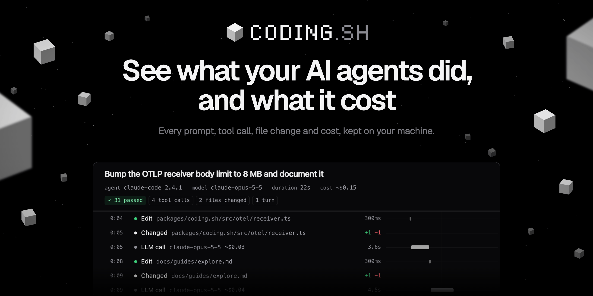
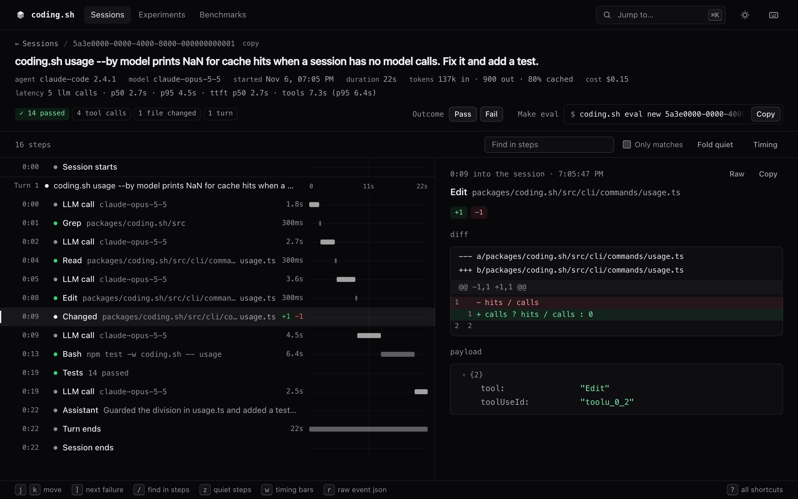
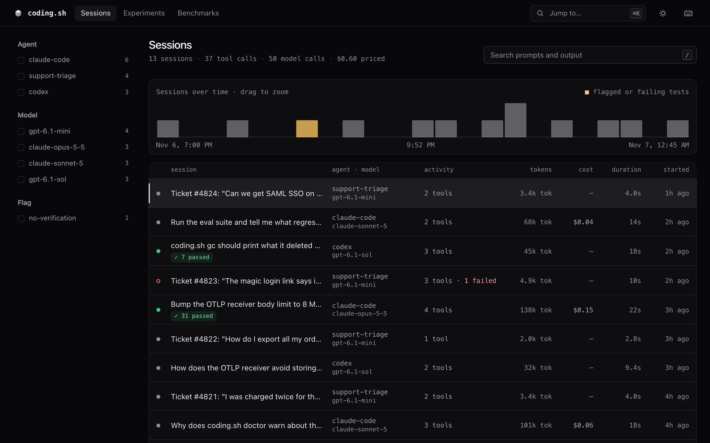

<p align="center">
  
</p>

<p align="center">
  <a href="https://github.com/jackulau/coding.sh/actions/workflows/ci.yml"></a>
  <a href="https://github.com/jackulau/coding.sh/releases/latest"></a>
  <a href="LICENSE"></a>
  
  <a href="https://github.com/jackulau/coding.sh/stargazers"></a>
</p>

<p align="center">
  <b>coding.sh records what your AI agents do: every prompt, model call, tool call, file change and what it cost. You read each run in a local viewer and turn the ones that went wrong into evals.<br>
  Your sessions stay on your machine.</b>
</p>

<p align="center">
  <a href="https://coding.sh/docs">Docs</a> ·
  <a href="https://coding.sh/docs/quickstart">Quickstart</a> ·
  <a href="#supported-agents">Supported agents</a> ·
  <a href="https://coding.sh/changelog">Changelog</a> ·
  <a href="https://github.com/jackulau/coding.sh/discussions">Discussions</a> ·
  <a href="https://github.com/jackulau/coding.sh/issues/new/choose">Report a bug</a>
</p>

```sh
npx coding.sh                               # try it: finds your agents, asks once, imports past sessions
curl -fsSL https://coding.sh/install | sh   # or install it: same setup, then opens the viewer
```

<p align="center">
  
  <br>
  <sub>A first run of <code>npx coding.sh</code> 0.1.6 in a fresh home.</sub>
</p>

Run `npx coding.sh` again to open the viewer on your sessions.

**What it costs:** nothing. MIT licensed, runs on your machine, no account.

<p align="center">
  
  <br>
  <sub>One Claude Code session in the local viewer (<code>coding.sh ui</code>), with the diff it made and the tests it ran.</sub>
</p>

coding.sh records what your agents do: prompts, tool calls, file changes, model calls, latency and
tokens. It goes into a SQLite index on your machine. You browse it in a local viewer, query it from
the CLI or from your agents over MCP, turn failures into evals, and compare changes with paired
statistics. Capture, storage and the viewer stay on your machine unless you add a remote sink.

No runtime dependencies, Node 22.15 or newer.

## Quickstart

`npx coding.sh` runs the latest release from npm without installing it. In a terminal, the first
run is `coding.sh init` and later runs open the viewer. The install command above installs the
release, runs `init`, opens the viewer, and puts `coding.sh` on your PATH for the commands below.
`init` finds your agents, shows one plan and asks once. It points their hooks at
coding.sh, registers the MCP server where the agent supports it, and backs up every config file it
edits. `coding.sh init --dry-run` prints the plan without writing anything (`--diff` adds the edits), and
`coding.sh uninstall` removes the hooks and MCP entries again.

`init` also imports the sessions your agents already keep on this machine, so the viewer opens on
your own history; `--no-import` skips that. Then start a new agent session: agents read their hooks
when a session starts, so one already open while `init` ran may not be recorded. New sessions show
up on their own, with no ingest step, and your agents can read them over MCP. To import past sessions again, for example after adding an agent:

```sh
coding.sh ingest --backfill
```

You can also install with npm: `npm install -g coding.sh`. If you only ran `npx coding.sh`, the
hooks keep recording, but the MCP server runs the copy in the npx cache, so install it before you
clear that cache. Installing from source, updates and uninstall:
[docs/guides/install.md](docs/guides/install.md).

## What you get

**Record.** Hooks and transcripts capture each session, including subagents.
`coding.sh run -- <cmd>` wraps any other agent and snapshots the repo before and after.
`coding.sh collector` takes OpenTelemetry from agent frameworks and apps.
`coding.sh init --proxy` routes Claude Code and Codex through a local API proxy that logs each model
call's system prompt, tools, messages and cache use. More in
[docs/how-to/capture-with-proxy.md](docs/how-to/capture-with-proxy.md).

**Measure.** Every session has its turns, tool calls, model calls, tokens, latency and outcome.
Sessions that edited code and never ran a check get a `no-verification` flag. `coding.sh improve`
says what to fix first and the line that fixes it.

<p align="center">
  
</p>

```sh
coding.sh sessions             # recent sessions
coding.sh show latest          # timeline with turns, tools, subagents and latency
coding.sh search "rate limit"  # full-text search over prompts, replies and tool calls
coding.sh usage --by model     # tokens, turns and cache hits
coding.sh stats --by agent     # sessions, failures, cost and latency per agent, with a daily trend
coding.sh diff-calls latest#-1 # what changed since the previous model call, and why the cache missed
coding.sh ui                   # the local viewer
```

Every command takes `--json`. `coding.sh mcp` gives your agents the same data as MCP tools.
More in [docs/guides/explore.md](docs/guides/explore.md).

**Compare.** Turn a failed session into a replayable eval with `coding.sh eval new`, and check
that its verifier is fair with `coding.sh eval validate`. Run experiments over versioned datasets
with code graders or calibrated LLM judges. `coding.sh exp compare` and `coding.sh compare` A/B
prompts, harness files and models with paired statistics. `coding.sh exp replay` resends one logged
model call with another model or system prompt. Tool evals and multi-agent workflow
runs are covered too. More in [docs/guides/evals.md](docs/guides/evals.md).

**Benchmark.** `coding.sh bench` draws new cases every day from a script, your failed sessions,
GitHub issues or a sitemap. Every contender gets the same frozen set in random order, and
`bench report` writes a static page with the trend, today's head to head and where each one
fails. More in [docs/guides/benchmarks.md](docs/guides/benchmarks.md).

**Production.** `coding.sh serve` runs ingest, the viewer and the API on one port, backed by
SQLite, Postgres or ClickHouse. Your API apps send traces with the TypeScript SDK (`@codingdotsh/sdk`), the
Python SDK (`coding-sh`) or plain OpenTelemetry. `coding.sh gateway` links calls made through LLM
gateways (Vercel AI Gateway, OpenRouter, LiteLLM, Cloudflare, Portkey, Helicone) to their billed
cost. The TypeScript SDK and the store plugins are on npm, and the Python SDK is on PyPI. Start with
[docs/production/README.md](docs/production/README.md).

## Supported agents

| Agent | How it records | Status |
|---|---|---|
| Claude Code | hooks, transcript, subagents | Verified on real sessions |
| Codex CLI | hooks, rollout files, subagents | Verified on real sessions |
| Antigravity CLI (formerly Gemini CLI) | hooks, transcript | Verified on real sessions |
| OpenCode | plugin, session database | Verified on a real install |
| Cursor CLI | hooks, transcript | Not run live |
| GitHub Copilot CLI | hooks, session state | Verified on a real install |
| Factory Droid | hooks, transcript | Verified on a real install |
| Goose | plugin hooks, session database | Verified on a real install |
| Pi | extension, transcript | Verified on a real install |
| Amp | plugin | Not run live |
| T3 Code | its local store | Verified on a real install |
| Aider | `coding.sh run -- aider …` | Verified on a real install |
| Any other command | `coding.sh run -- <cmd>` | Tested |
| Your own agent or app (Vercel AI SDK, Claude Agent SDK, OpenAI Agents SDK, LangGraph and more) | OpenTelemetry into `coding.sh collector`, or the TypeScript and Python SDKs | Tested |

Verified on a real install means the agent's current release was installed and run through a
session against a local stub model, its hooks fired and the recorded session was checked, and the
captured payloads are now CI fixtures. For OpenCode, Pi, Goose, Factory Droid, GitHub Copilot CLI
and Aider, CI repeats that run on Linux and Windows on every change. Not run live means CI checks
the adapter against the agent's documented formats, but nobody has run it against a live install
yet. Cursor CLI and Amp are in that state because both need an account login. If you use one of
them, a short
[agent support report](https://github.com/jackulau/coding.sh/issues/new?template=agent-support.yml)
saying whether it works moves it to "Verified". Per-agent details, including which agents get the
MCP server, are in [docs/guides/agents.md](docs/guides/agents.md). Guides for one agent:
[coding.sh with T3 Code](docs/use-cases/t3-code.md) and [coding.sh with Pi](docs/use-cases/pi.md).

## Privacy

With no sinks configured, no session data leaves your machine. The only default network request is
a daily update check, which `CODING_SH_NO_UPDATE_CHECK=1` turns off. Secrets are redacted at
ingest, before anything is written to the index, blobs or sinks. The hook first writes the agent's
payload unredacted to `~/.coding.sh/spool` (mode 600). Ingest redacts the payloads kept in
`spool/<agent>/raw/` in place; a payload written inside its spool line stays unredacted until
`coding.sh gc` deletes the file after 7 days. Remote sinks send metadata only unless you opt in to
full content. Details in [docs/guides/privacy.md](docs/guides/privacy.md).

## Status

coding.sh is pre-1.0 (latest: 0.1.6), so expect rough edges. What isn't done yet:

- CI runs on Linux, macOS and Windows. On Windows, CI runs the test suite, the installer (from
  Git Bash) and real OpenCode, Pi, Goose, Factory Droid, GitHub Copilot CLI and Aider sessions
  against a stub model. Capture from Claude Code, Codex CLI, Antigravity CLI, Cursor CLI, Amp and
  T3 Code has not been checked on Windows yet.
- Two adapters, Cursor CLI and Amp, have not been run on a live install yet. Both need an account
  login (see [Supported agents](#supported-agents)).

Changes are listed in [CHANGELOG.md](CHANGELOG.md) and on the
[releases page](https://github.com/jackulau/coding.sh/releases).

## Getting help

- **Questions and ideas:** [Discussions](https://github.com/jackulau/coding.sh/discussions).
- **Bugs:** [open an issue](https://github.com/jackulau/coding.sh/issues/new/choose). The bug form
  asks for the output of `coding.sh doctor`, which answers most first questions.
- **A new agent, or a report on one not run live yet:** the
  [agent support form](https://github.com/jackulau/coding.sh/issues/new?template=agent-support.yml).
- **Security issues:** report them privately through [SECURITY.md](SECURITY.md), not as an issue.

## Docs

- [coding.sh/docs](https://coding.sh/docs): quickstart, agents, CLI, MCP, evals, OpenTelemetry,
  storage and the trace format.
- [docs/](docs/README.md): the same guides in Markdown, plus production, design specs and
  research.
- [docs/troubleshooting.md](docs/troubleshooting.md): what to check when sessions don't show up.

## Repository layout

```
packages/
  coding.sh/        the CLI, hook, adapters, OTLP receiver, viewer, MCP server and evals
  sdk/              TypeScript SDK for API apps
  sdk-python/       Python SDK
  store-postgres/   Postgres store plugin
  store-clickhouse/ ClickHouse store plugin
  blob-s3/          S3 blob store plugin
apps/site/          coding.sh website (Astro, static)
docs/               guides, production, reference and design docs
examples/           an eve agent, production apps, a plugin A/B and a skill eval
deploy/             deploy recipes for Compose, Fly, Railway and ClickHouse (Render uses render.yaml)
evals/              coding.sh's own CLI eval suite
scripts/dogfood/    the scorecard coding.sh runs on itself
```

## Contributing

See [CONTRIBUTING.md](CONTRIBUTING.md) for setup and the codebase map. Issues labeled
[good first issue](https://github.com/jackulau/coding.sh/labels/good%20first%20issue) are small and
self-contained. Release steps are in [docs/RELEASE.md](docs/RELEASE.md).

## Star history

<a href="https://star-history.com/#jackulau/coding.sh&Date"><picture><source media="(prefers-color-scheme: dark)" srcset="https://api.star-history.com/svg?repos=jackulau/coding.sh&type=Date&theme=dark" /><source media="(prefers-color-scheme: light)" srcset="https://api.star-history.com/svg?repos=jackulau/coding.sh&type=Date" /></picture></a>

## License

[MIT](LICENSE)
