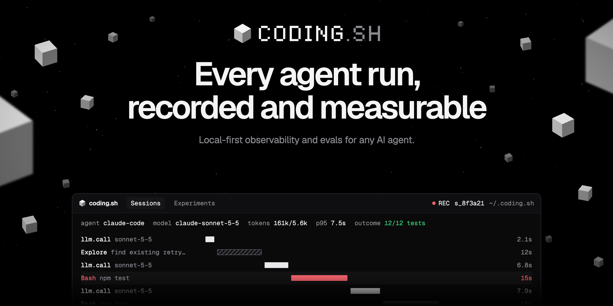

<p align="center">
  
</p>

# coding.sh

Open-source, local-first observability and evals for any AI agent. Coding agents first-class.

coding.sh records what your agents do (prompts, tool calls, file changes, model calls, latency and
token usage) into a SQLite index on your machine. You browse it in a local viewer, query it from
the CLI or from your agents over MCP, turn failures into evals, and compare changes with paired
statistics. Zero runtime dependencies. Node 22.15 or newer.

## Quickstart

```sh
npm install -g coding.sh
coding.sh init     # finds your agents, shows one plan, asks once (Y/n)
coding.sh          # opens the viewer
```

`init` points each detected agent's hooks at `~/.coding.sh/bin/hook.mjs` and registers the
coding.sh MCP server with Claude Code, Codex, Cursor and OpenCode. Every config file it
edits is backed up first. `coding.sh init --dry-run` shows the plan (agents, files, blockers) without writing
anything; add `--diff` for the exact edits. After that, use your agents as usual. New sessions appear without an ingest step.

`npx coding.sh init` works too. The hook is copied to a stable path, but the MCP entry then points
at the npx cache, so a global install is the sturdier choice.

Commands print one dim line when a newer release is out (checked in the background, at most once a
day). `coding.sh update` installs it. Turn the check off with `NO_UPDATE_NOTIFIER=1`,
`CODING_SH_NO_UPDATE_CHECK=1` or `[update] check = false` in `~/.coding.sh/config.toml`.

## Agents

Verified on real sessions: **Claude Code**, **Codex CLI** (approve the hooks once with `/hooks`),
**Antigravity CLI** (formerly Gemini CLI).
Verified on a real install (current release against a local stub model): OpenCode, GitHub
Copilot CLI, Factory Droid, Goose, Pi, T3 Code, Aider.
Fixture-tested: Cursor CLI, Amp (both need an account login).
Any other command: `coding.sh run -- <cmd>` takes shadow-git snapshots before and after.
Agent frameworks and apps can also send OpenTelemetry to `coding.sh collector`.

## Any agent over OpenTelemetry

```sh
coding.sh collector     # OTLP/HTTP on 127.0.0.1:4318; prints the OTEL_* env to export
```

It accepts traces and logs as protobuf or JSON and understands OTel GenAI semantic conventions,
OpenInference, Vercel AI SDK spans and Claude Code, Codex and Gemini CLI log events.

## Commands

| Group | Commands |
|---|---|
| Capture | `init`, `doctor`, `status`, `ingest [--backfill]`, `run -- <cmd>`, `collector`, `uninstall` |
| Explore | `sessions`, `show <id\|latest>`, `search <text>`, `usage`, `ui`, `mcp` |
| Evaluate | `eval new\|validate\|list\|export`, `dataset`, `exp run\|compare`, `judge calibrate`, `toolevals`, `workflows`, `bench new\|run\|history\|report\|schedule` |
| Harness | `harness snapshot\|list`, `compare A B` |
| Maintain | `gateway`, `gc`, `config`, `update`, `version` |

Every command takes `--json` and `--help`.

## Privacy

With no sinks configured, no session data is sent anywhere. The only default network request is
the daily update check, which can be turned off. Secrets are redacted at ingest, before anything
reaches the index, blobs or sinks. `[capture] mode = "metadata"` keeps structure and numbers only.
Remote sinks (`otlp`, `http`) send metadata only unless you set `mode = "full"`. Raw hook payloads
wait in `~/.coding.sh/spool` (mode 600) until they are ingested, and `coding.sh gc` removes old
spool files.

## Uninstall

```sh
coding.sh uninstall --yes   # restores agent configs; captured data in ~/.coding.sh is kept
npm uninstall -g coding.sh
```

## Library

`coding.sh/schema` exports the trace schema constants: `SCHEMA_ID`, `SCHEMA_VERSION`, `EVENT_KINDS`,
`KNOWN_AGENTS` and `isEventKind()`. TypeScript types are not shipped yet.

Docs: [coding.sh/docs](https://coding.sh/docs/). Source, the agent matrix and the privacy details:
[github.com/jackulau/coding.sh](https://github.com/jackulau/coding.sh). MIT licensed.
